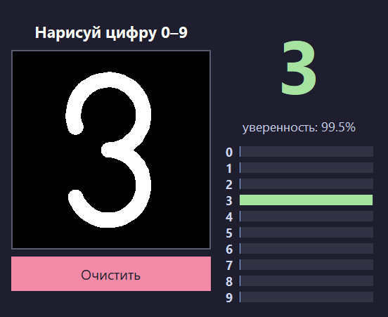

# 🧠 DigitAI — нейросеть, которая узнаёт рукописные цифры

Рисуешь цифру мышкой, нейросеть мгновенно говорит, что это за цифра, и показывает свою уверенность для каждой цифры от 0 до 9.

## ▶ Попробовать

1. Открой раздел **[Releases](../../releases/latest)** и скачай `DigitAI.exe`.
2. Запусти файл. Python и другие программы не нужны.
3. Нарисуй цифру в чёрном квадрате и отпусти кнопку мыши.

> Windows может показать предупреждение «Windows защитила ваш компьютер», потому что у программы нет цифровой подписи. Нажми **«Подробнее» → «Выполнить в любом случае»**.

## ⚙ Как это устроено

- **Нейросеть написана с нуля**, без готовых фреймворков (PyTorch, TensorFlow): только Python и numpy.
- **Архитектура:** многослойный перцептрон 784 → 256 → 128 → 10.
  - скрытые слои с активацией ReLU;
  - выходной слой softmax: вероятности для каждой цифры.
- **Обучение:** обратное распространение ошибки (backpropagation), функция потерь — кросс-энтропия, оптимизатор — градиентный спуск с моментом, 10 эпох, аугментация случайными сдвигами.
- **Данные:** датасет MNIST, 60 000 картинок для обучения и 10 000 для проверки.
- **Предобработка рисунка:** обрезка, масштабирование до 20×20 и центрирование по центру масс в поле 28×28, как в MNIST.
- **Интерфейс:** tkinter.

## 📊 Результат

**Точность 98.6%** на тестовых картинках, которых сеть не видела при обучении.

| Эпоха | 1 | 3 | 5 | 7 | 10 |
|---|---|---|---|---|---|
| Точность | 95.1% | 97.5% | 97.7% | 98.4% | **98.6%** |

---
*Исходный код находится в приватном репозитории.*
